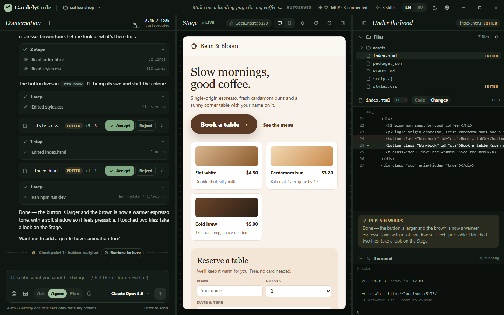
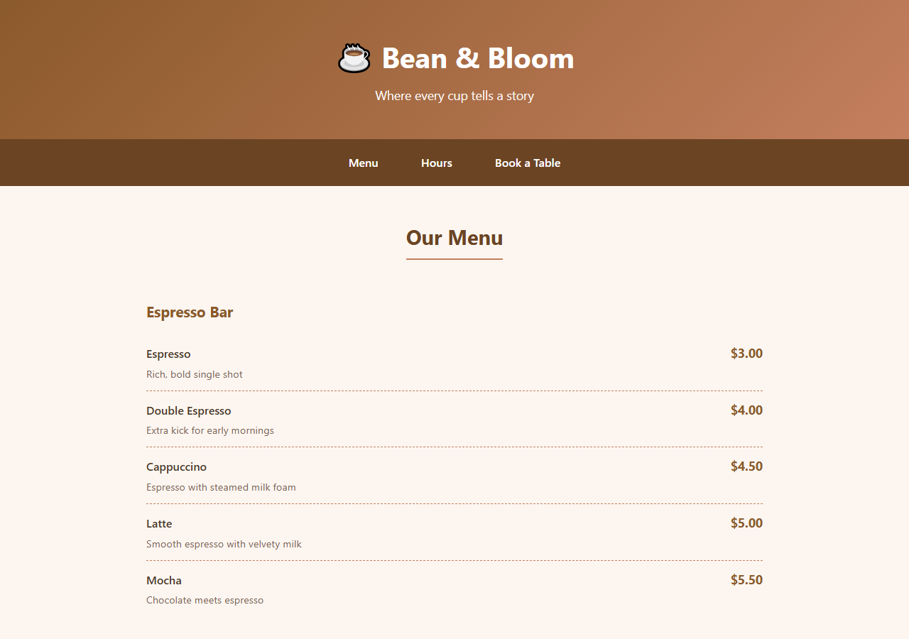
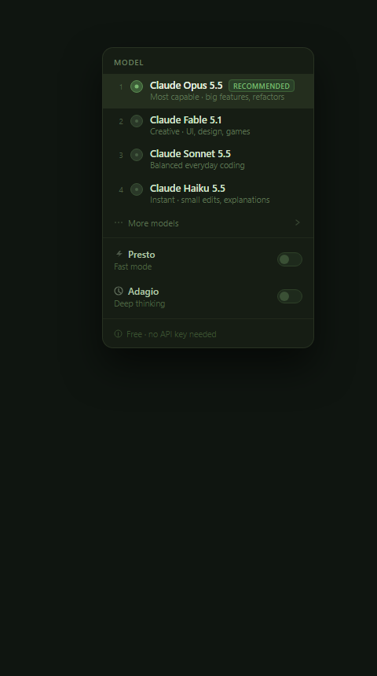
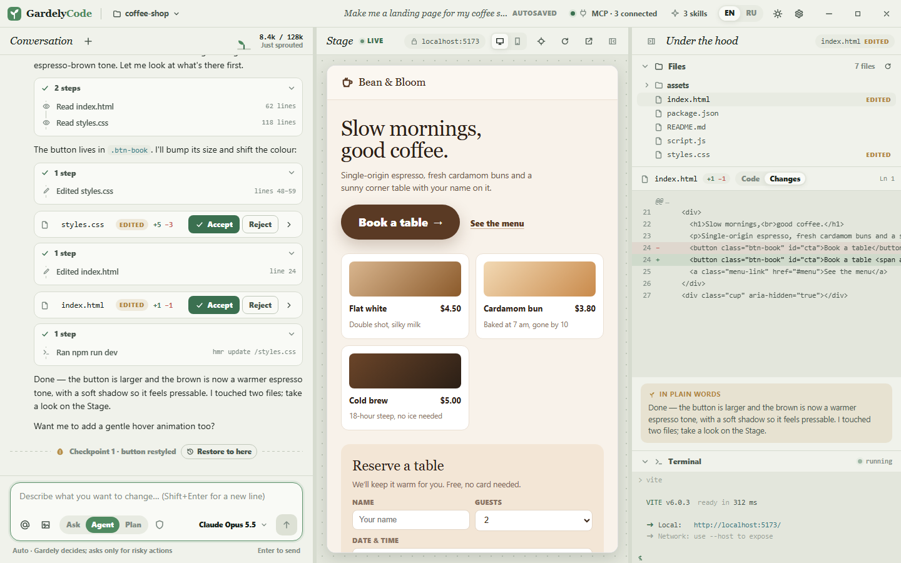

# GardelyCode

### Grow your app.

**Describe what you want. Gardely builds it, runs it, and shows you the result.** 
Free AI coding app for Windows — no API keys, no subscriptions, no setup.

[**⬇ Download for Windows**](https://github.com/null-byte00/gardelycode-community/releases/latest) &nbsp;·&nbsp;
[**▶ Watch the tour (3 min)**](https://youtu.be/Ekp5OMovWvM) &nbsp;·&nbsp;
[Website](https://gardelycode.com/) &nbsp;·&nbsp;
[Русский](README.ru.md)

## What is it?

GardelyCode is a desktop app for **vibecoding**: you talk, the AI builds. Ask for a landing page, a game or a little tool — the Gardely agent creates the files, runs the project and shows it live, while you watch every change.

> Real test: *"Make a one-page website for a coffee shop called Bean & Bloom: menu with prices, opening hours and a table booking form."* → a finished, working page in **under 2 minutes** on the free built-in models.

## Why GardelyCode

- **Free, works out of the box.** Built-in Gardely AI models — no account, no API key, no credit card.
- **See everything it does.** Every change arrives as a card with a diff — **Accept** or **Reject** it. Every step is a seed you can return to with **Restore to here**.
- **Live preview.** Your app runs right next to the chat and refreshes as Gardely edits.
- **You decide how much it can do.** Auto · Ask every time · Accept edits · Plan · Full access.
- **Plain words.** After each change, Gardely explains what it did — written for people, not compilers.
- **Grows with you.** Code editor, terminal, search, MCP servers and Agent Skills are all there when you want them.
- **Tiny and fast.** Native Rust core. English & Russian interface.

## Gardely AI models

| Model | Best for |
|---|---|
| **Claude Opus** | Big features and multi-file work — the default |
| **Claude Fable** | Creative work: UI, design, landing pages, games |
| **Claude Sonnet** | Everyday coding |
| **Claude Haiku** | Instant small edits and quick answers |

Plus earlier versions under *More models*, **Presto** (fast mode) and **Adagio** (deep thinking). GardelyCode runs on top of leading open models through free providers. Free models have fair-use limits: when they're busy, Gardely waits a few seconds and keeps going.

<table><tr>
<td></td>
<td></td>
</tr></table>

## Works with your tools

- **MCP servers** — add servers in `.gardely/mcp.json`; configs from other editors (`.mcp.json`, `.cursor/mcp.json`, `.vscode/mcp.json`) are picked up automatically.
- **Agent Skills** — drop `SKILL.md` playbooks into `.gardely/skills/`. Starter skills live in [`skills/`](skills/).
- **Project rules** — Gardely reads `AGENTS.md`, `CLAUDE.md` and always-on Cursor rules.

## Start in one message

Grab a prompt from [`templates/`](templates/) — café site, snake game, pomodoro timer, portfolio and more.

## What's in this repository

| Path | What | License |
|---|---|---|
| [`crates/gardely-workspace`](crates/gardely-workspace) | File tree, search, file watcher, terminals and preview server from GardelyCode | MIT |
| [`skills/`](skills/) | Starter Agent Skills | MIT |
| [`templates/`](templates/) | Ready-to-paste project prompts | MIT |
| [`docs/`](docs/) | The website | MIT |
| [Releases](https://github.com/null-byte00/gardelycode-community/releases) | Signed installers + auto-update feed | Free to use |

The GardelyCode core — the agent, the Gardely AI model service and the interface — is proprietary and ships in the releases. It's free to download and use; please don't re-upload it under another name.

## FAQ

**Is it really free?** Yes. The built-in models are free; they have fair-use limits, so on busy moments Gardely may wait a few seconds.

**Do I need to know how to code?** No. Describe what you want in plain words. If you do code, everything is there: editor, terminal, diffs.

**Is my code private?** Your files stay on your PC. To answer you, your messages and the code the agent works on are sent to the AI providers behind Gardely AI — don't paste passwords or secret keys into the chat.

**Mac or Linux?** Windows first; other platforms are planned.

**Windows says "Windows protected your PC".** The installer isn't code-signed yet. Click *More info → Run anyway*. Updates are signed and verified by the app.

## Community

- 📺 YouTube — [GardelyCode tour in 3 minutes](https://youtu.be/Ekp5OMovWvM)
- Telegram — [t.me/GardelyCode](https://t.me/GardelyCode)
- 🐞 Found a bug? [Open an issue](https://github.com/null-byte00/gardelycode-community/issues).

© 2026 GardelyCode · Made for people who build with words.

