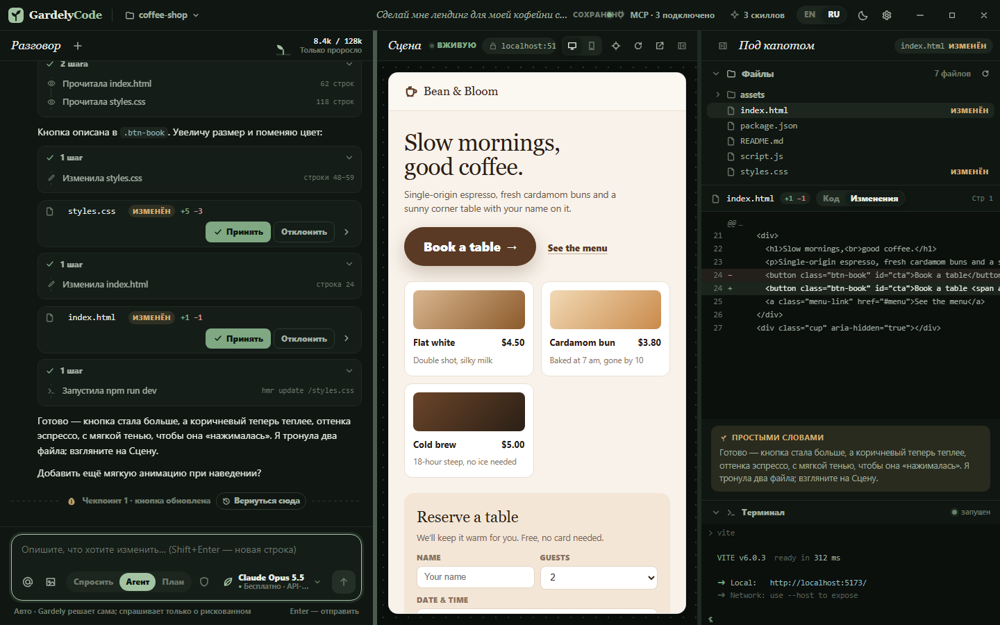

# GardelyCode

### Вырасти своё приложение.

**Опиши, что хочешь. Gardely сделает, запустит и покажет результат.** 
Бесплатный ИИ для создания программ на Windows — без API-ключей, подписок и настройки.

[**⬇ Скачать для Windows**](https://github.com/null-byte00/gardelycode-community/releases/latest) &nbsp;·&nbsp;
[**▶ Тур по приложению (3 мин, EN)**](https://youtu.be/Ekp5OMovWvM) &nbsp;·&nbsp;
[Сайт](https://gardelycode.com/) &nbsp;·&nbsp;
[English](README.md)

## Что это?

GardelyCode — программа для **вайбкодинга**: ты пишешь, ИИ делает. Попроси лендинг, игру или полезную утилиту — агент Gardely создаст файлы, запустит проект и покажет его вживую, а ты видишь каждое изменение.

> Реальный тест: *«Сделай одностраничный лендинг для кофейни с меню и формой бронирования»* → готовая рабочая страница **меньше чем за 2 минуты** на встроенных бесплатных моделях.

## Почему GardelyCode

- **Бесплатно и сразу работает.** Встроенные модели Gardely AI — без регистрации, ключей и карты.
- **Видно всё, что он делает.** Каждое изменение — карточка с диффом: **Принять** или **Отклонить**. Каждый шаг — «семечко», к которому можно вернуться кнопкой **Вернуться сюда**.
- **Живое превью.** Приложение работает прямо рядом с чатом и обновляется на глазах.
- **Ты решаешь, что ему можно.** Auto · Спрашивать всегда · Принимать правки · План · Полный доступ.
- **Человеческим языком.** После каждого изменения Gardely объясняет, что сделал — для людей, а не для компиляторов.
- **Растёт вместе с тобой.** Редактор кода, терминал, поиск, MCP-серверы и скиллы — всё под рукой.
- **Лёгкий и быстрый.** Установщик ~6 МБ, нативное ядро на Rust. Интерфейс на русском и английском.

## Модели Gardely AI

| Модель | Для чего |
|---|---|
| **Claude Opus** | Большие фичи и работа со многими файлами — по умолчанию |
| **Claude Fable** | Творчество: интерфейсы, дизайн, лендинги, игры |
| **Claude Sonnet** | Повседневный код |
| **Claude Haiku** | Мгновенные мелкие правки и быстрые ответы |

Плюс прошлые версии в «Ещё модели», **Presto** (быстрый режим) и **Adagio** (глубокое обдумывание). GardelyCode работает на базе лучших открытых моделей через бесплатных провайдеров. У бесплатных моделей есть лимиты честного использования: когда они заняты, Gardely ждёт несколько секунд и продолжает.

## Что в этом репозитории

| Путь | Что | Лицензия |
|---|---|---|
| [`crates/gardely-workspace`](crates/gardely-workspace) | Дерево файлов, поиск, слежение за файлами, терминал и превью из GardelyCode | MIT |
| [`skills/`](skills/) | Стартовые скиллы | MIT |
| [`templates/`](templates/) | Готовые промпты для проектов | MIT |
| [Релизы](https://github.com/null-byte00/gardelycode-community/releases) | Подписанные установщики и автообновления | Бесплатно |

Ядро GardelyCode — агент, сервис моделей Gardely AI и интерфейс — закрытое и поставляется в релизах. Скачивать и пользоваться можно бесплатно; перезаливать под другим именем — нельзя.

## Вопросы

**Это правда бесплатно?** Да. Встроенные модели бесплатные; у них есть лимиты, поэтому иногда Gardely ждёт пару секунд.

**Нужно уметь программировать?** Нет. Опиши словами, что хочешь. А если умеешь — всё есть: редактор, терминал, диффы.

**Мой код в безопасности?** Файлы остаются на твоём компьютере. Чтобы ответить, твои сообщения и код, с которым работает агент, отправляются ИИ-провайдерам Gardely AI — не вставляй в чат пароли и секретные ключи.

**Windows пишет «Система Windows защитила ваш компьютер».** У установщика пока нет цифровой подписи. Нажми *Подробнее → Выполнить в любом случае*. Обновления подписаны и проверяются программой.

## Сообщество

- 📺 YouTube — [тур по GardelyCode за 3 минуты (EN)](https://youtu.be/Ekp5OMovWvM)
- Telegram — [t.me/GardelyCode](https://t.me/GardelyCode)
- 🐞 Нашёл баг? [Создай issue](https://github.com/null-byte00/gardelycode-community/issues).

© 2026 GardelyCode · Для тех, кто создаёт словами.

